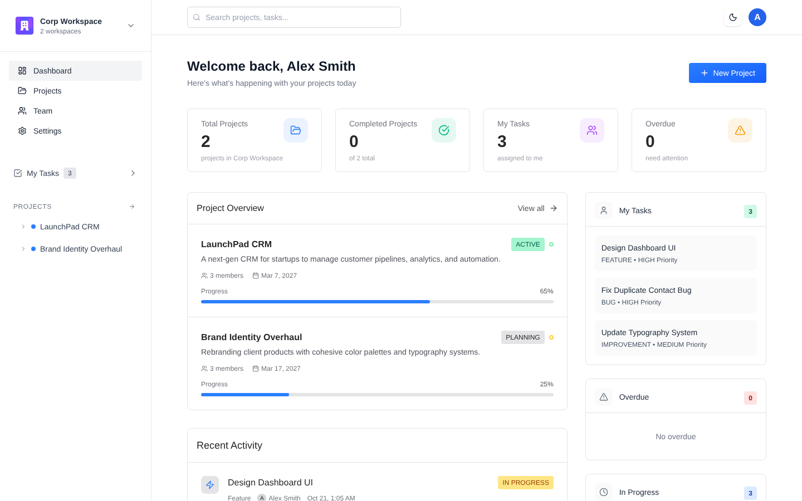
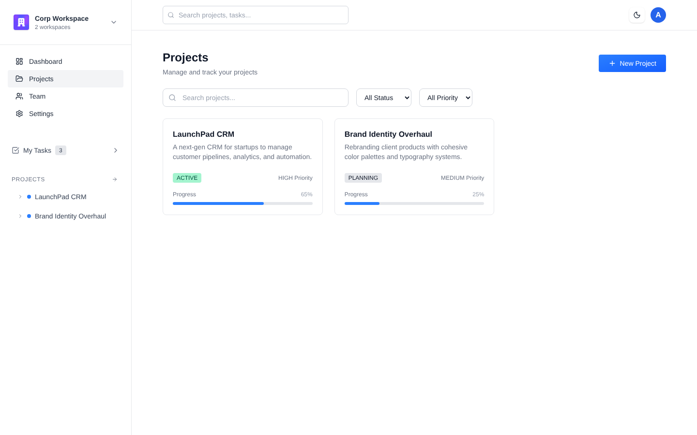
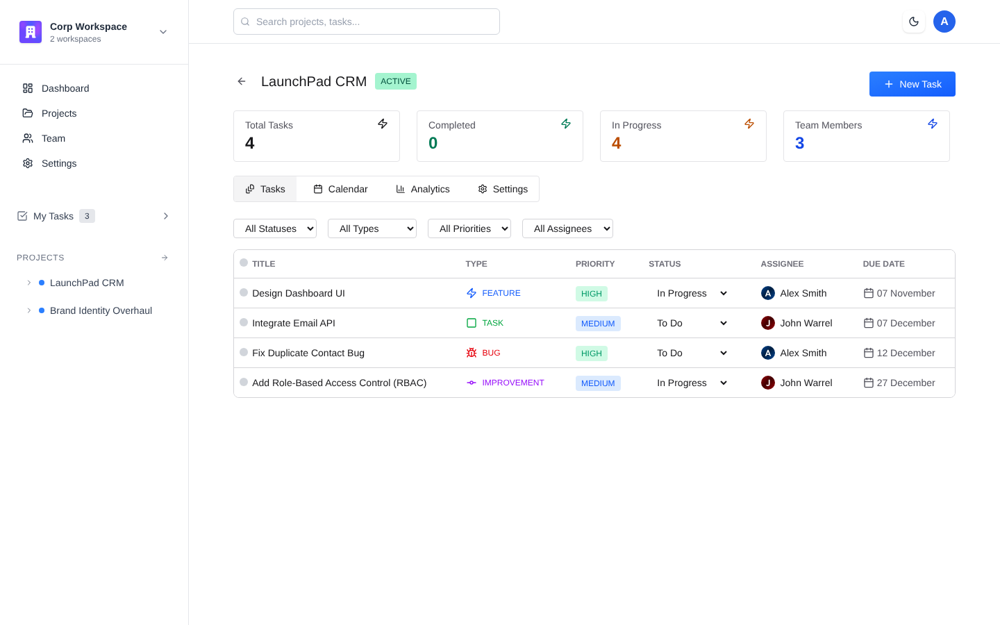
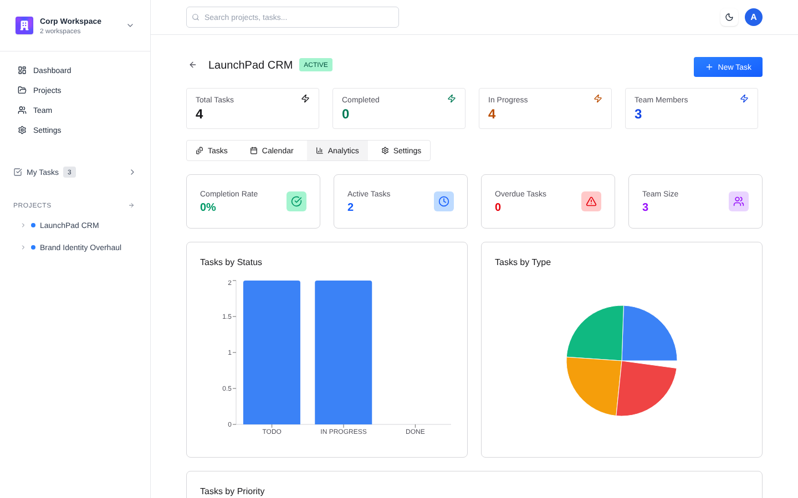
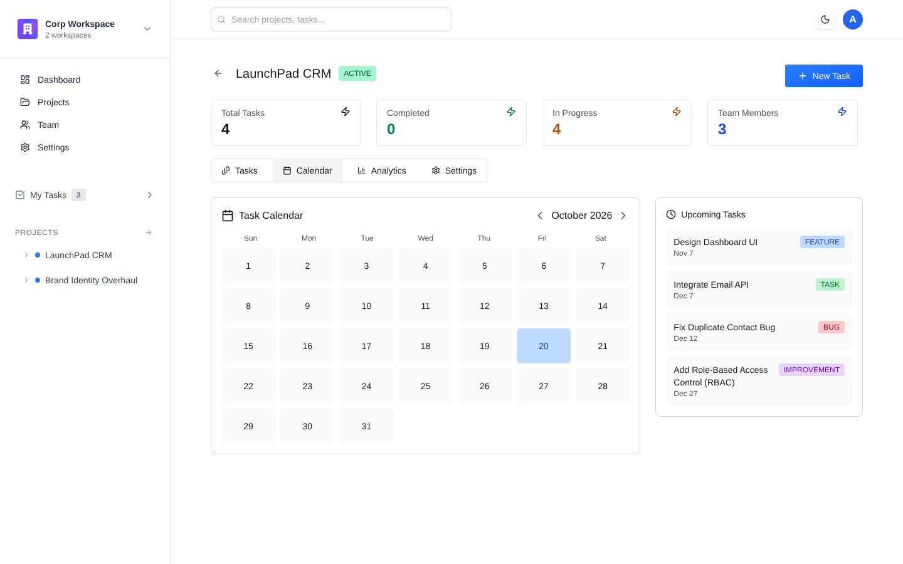
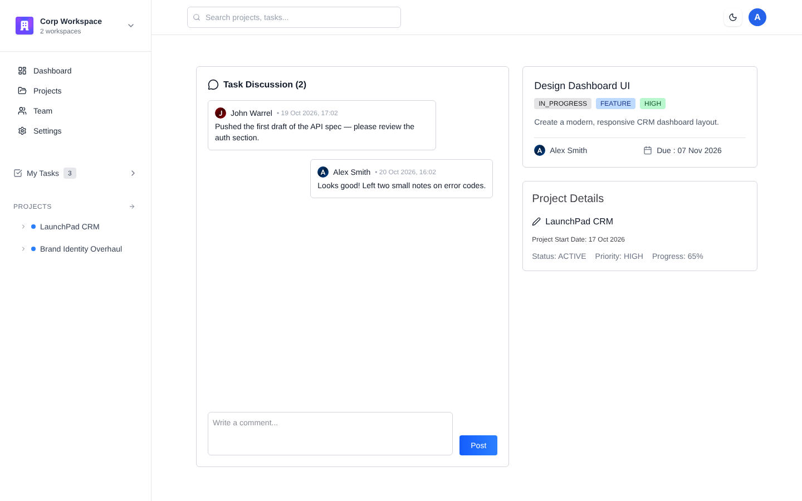
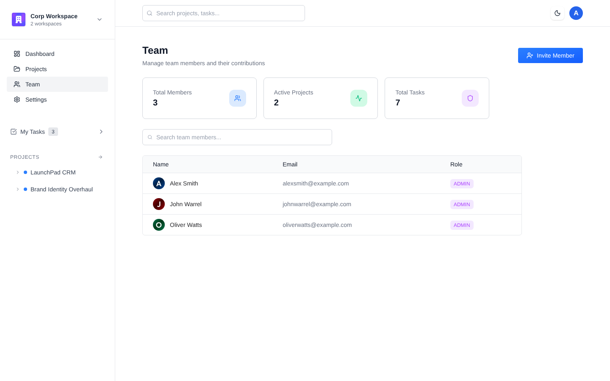
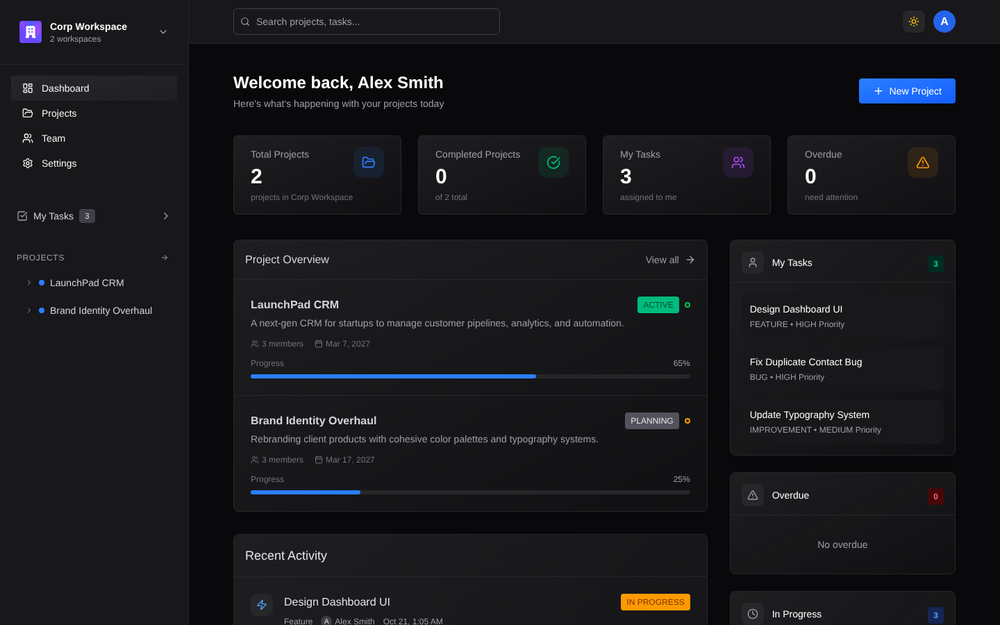
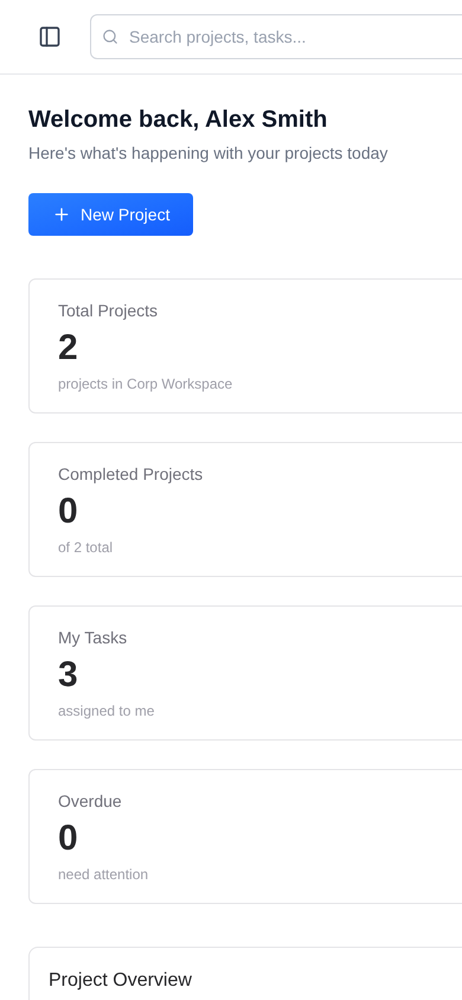
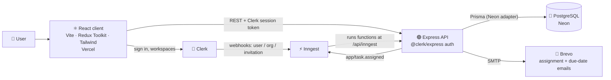

<div align="center">

# 🗂️ NeatDesk

### Plan projects, assign tasks, and keep your team in sync.

A full-stack team project-management app: workspaces with roles, projects, tasks,
comments, analytics, a calendar, and email reminders that go out automatically when a task is assigned and again on its due date.

[](https://neat-desk.vercel.app/)
[](https://github.com/ARYAN10227/NeatDesk/actions/workflows/ci.yml)




</div>

---

## ✨ Features

| | |
|---|---|
| 🏢 **Workspaces** | Separate workspaces (Clerk organizations) with **Admin** and **Member** roles; switch between them from the sidebar |
| 📁 **Projects** | Status, priority, start/end dates, progress, a team lead and project members |
| ✅ **Tasks** | Task / Bug / Feature / Improvement types, priorities, assignees, due dates; filter by status, type, priority and assignee; bulk delete |
| 💬 **Comments** | Discuss each task in a thread that refreshes every 10 seconds |
| 📊 **Analytics** | Completion rate, overdue count, and charts of tasks by status, type and priority |
| 📅 **Calendar** | Month view of due dates, plus a list of upcoming tasks |
| 👥 **Team** | Invite people to a workspace by email; see members and their roles |
| 📧 **Email reminders** | When a task is assigned, the assignee gets an email; on the due date, a reminder goes out if the task isn't done (Inngest + Brevo SMTP) |
| 🔄 **Clerk sync** | Clerk webhooks (users, organizations, invitations) keep the PostgreSQL database in step, through Inngest |
| 🌗 **Dark mode** | Theme toggle that's remembered between visits |
| 📱 **Responsive** | Collapsible sidebar; works on phones |

## 🖼️ Screenshots

<table>
<tr>
<td width="50%"><b>Projects</b><br/></td>
<td width="50%"><b>Project tasks</b> — filters, inline status changes<br/></td>
</tr>
<tr>
<td width="50%"><b>Analytics</b><br/></td>
<td width="50%"><b>Calendar</b><br/></td>
</tr>
<tr>
<td width="50%"><b>Task details & discussion</b><br/></td>
<td width="50%"><b>Team</b><br/></td>
</tr>
<tr>
<td width="50%"><b>Dark mode</b><br/></td>
<td width="50%" align="center"><b>Mobile</b><br/></td>
</tr>
</table>

<sub>Screenshots use sample data.</sub>

## 🧩 Architecture



**How a request flows**

1. The client gets a session token from Clerk and sends it as `Authorization: Bearer …`.
2. `clerkMiddleware()` verifies it; the `protect` middleware rejects anything without a user (401).
3. Controllers check permissions against the database, never against ids sent by the client:
   only workspace **admins** create projects, the **team lead** manages a project's tasks and members, and only
   **workspace members** can read or post comments.
4. Creating a task emits an `app/task.assigned` event. An Inngest function emails the assignee, sleeps until
   the due date, and sends a reminder if the task still isn't `DONE`.

**Data model** (`server/prisma/schema.prisma`): `User`, `Workspace`, `WorkspaceMember` (ADMIN/MEMBER),
`Project`, `ProjectMember`, `Task`, `Comment`; cascading deletes and unique membership constraints.

## 🛠️ Tech stack

| Layer | Tools |
|---|---|
| **Frontend** | React 19, Vite 7, Tailwind CSS 4, Redux Toolkit, React Router 7, Recharts, date-fns, lucide-react, react-hot-toast, Axios |
| **Backend** | Node.js, Express 5, Prisma 7 with the Neon serverless adapter, PostgreSQL (Neon) |
| **Auth** | Clerk (`@clerk/clerk-react` on the client, `@clerk/express` on the server), organizations as workspaces |
| **Jobs & email** | Inngest (webhook sync, delayed reminders), Nodemailer over Brevo SMTP |
| **Tooling** | ESLint, nodemon, GitHub Actions CI, Vercel |

## 🚀 Run locally

**Prerequisites:** Node.js 20+, a [Neon](https://neon.tech) (or any PostgreSQL) database, a [Clerk](https://clerk.com) app
with **Organizations** enabled, and optionally [Inngest](https://www.inngest.com) and Brevo SMTP for emails.

```sh
git clone https://github.com/ARYAN10227/NeatDesk.git
cd NeatDesk

# 1. API
cd server
npm install
cp .env.example .env        # fill in DATABASE_URL, Clerk keys, Inngest and SMTP
npx prisma generate
npx prisma db push          # create the tables
npm run server              # → http://localhost:5000

# 2. Inngest dev server (second terminal, optional — needed for webhooks and emails)
npx inngest-cli@latest dev -u http://localhost:5000/api/inngest

# 3. Client (third terminal)
cd client
npm install
cp .env.example .env        # VITE_CLERK_PUBLISHABLE_KEY, VITE_BASEURL=http://localhost:5000
npm run dev                 # → http://localhost:5173
```

> Users and workspaces reach the database through Clerk webhooks, so in Clerk add a webhook that points to your
> Inngest endpoint (Inngest → *Integrations → Clerk*) for `user.*`, `organization.*` and `organizationInvitation.accepted`.

### Environment variables

| Where | Variable | Purpose |
|---|---|---|
| client | `VITE_CLERK_PUBLISHABLE_KEY` | Clerk publishable key |
| client | `VITE_BASEURL` | Base URL of the API, e.g. `http://localhost:5000` |
| client | `VITE_DEMO_EMAIL`, `VITE_DEMO_PASSWORD` | Optional: show a one-click demo sign-in card |
| server | `DATABASE_URL` | Neon / PostgreSQL connection string |
| server | `CLERK_PUBLISHABLE_KEY`, `CLERK_SECRET_KEY` | Verify Clerk session tokens |
| server | `INNGEST_EVENT_KEY`, `INNGEST_SIGNING_KEY` | Send events / secure the Inngest endpoint (production) |
| server | `SMTP_USER`, `SMTP_PASS`, `SENDER_EMAIL` | Brevo SMTP for task emails |
| server | `PORT` | Defaults to `5000` |

### Scripts

| | Script | What it does |
|---|---|---|
| client | `npm run dev` / `build` / `preview` / `lint` | Vite dev server, production build, preview, ESLint |
| server | `npm run server` | API with auto-reload (nodemon) |
| server | `npm start` | API in production mode |
| server | `npm run generate` / `db:push` | Generate the Prisma client / sync the schema to the database |
| server | `npm run check` | Syntax-check every server file (used in CI) |

## 📡 API

All routes except `/`, `/health` and `/api/inngest` need a Clerk session token.

| Method | Route | Who | Description |
|---|---|---|---|
| `GET` | `/api/workspaces` | member | Your workspaces, with members, projects, tasks and comments |
| `POST` | `/api/projects` | workspace admin | Create a project (optional team lead and members by email) |
| `PUT` | `/api/projects` | admin or team lead | Update a project |
| `POST` | `/api/projects/:projectId/addMember` | team lead | Add a workspace member to the project |
| `POST` | `/api/tasks` | team lead | Create a task and queue the assignment email |
| `PUT` | `/api/tasks/:id` | team lead | Update a task's title, description, status, type, priority, assignee or due date |
| `POST` | `/api/tasks/delete` | team lead | Delete several tasks of one project (`{ tasksIds: [...] }`) |
| `POST` | `/api/comments` | project member | Comment on a task |
| `GET` | `/api/comments/:taskId` | workspace member | A task's comments, oldest first |
| `GET` | `/health` | public | Health check |

## 📁 Project structure

```
NeatDesk/
├── client/                  React app (deployed to Vercel)
│   ├── src/
│   │   ├── pages/           Dashboard, Projects, ProjectDetails, TaskDetails, Team, Layout
│   │   ├── components/      Sidebar, Navbar, dialogs, task table, analytics, calendar, DemoSignIn …
│   │   ├── features/        Redux slices (workspace, theme)
│   │   ├── config/api.js    Axios instance (VITE_BASEURL)
│   │   └── app/store.js     Redux store
│   └── vercel.json          SPA rewrites so deep links survive a refresh
├── server/                  Express API
│   ├── controllers/         workspace, project, task, comment
│   ├── routes/              route definitions
│   ├── middlewares/         protect (Clerk auth)
│   ├── inngest/             Clerk sync + task email functions
│   ├── configs/             Prisma client, Nodemailer
│   └── prisma/              schema.prisma
├── docs/screenshots/
└── .github/workflows/ci.yml
```

## 🌐 Deployment

- **Client:** Vercel, root directory `client`; `vercel.json` rewrites every path to `index.html`.
  Set `VITE_CLERK_PUBLISHABLE_KEY` and `VITE_BASEURL` in the Vercel project.
- **API:** any Node host. Set the server variables above and make sure `prisma generate` runs at build time.
- **Inngest:** register the deployed `/api/inngest` URL in the Inngest dashboard.
- **CI:** every push and pull request lints and builds the client and validates the server (GitHub Actions).

## 🙏 Credits

The UI is based on [GreatStackDev/project-management](https://github.com/GreatStackDev/project-management) (MIT).
NeatDesk extends it with a one-click demo sign-in, stricter server-side permission checks, retry-safe Clerk sync,
input validation, bug fixes, CI and documentation. See [LICENSE](LICENSE).

---

<div align="center">

### 👋 Built by Aryan Raj

[](https://github.com/ARYAN10227)
[](https://linkedin.com/in/aryan-raj-2b3868340)
[](mailto:aryanrajpersonal12@gmail.com)

⭐ If you like this project, consider giving it a star!

</div>
